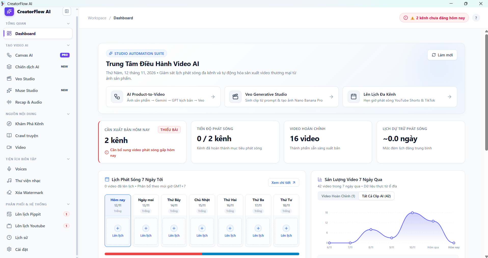

# CreatorFlow AI (Google Search Studio)



Ứng dụng **desktop Windows (Electron)** tự động hóa sản xuất video bằng AI. Repo này là mã nguồn để dev cùng làm việc: cách dựng môi trường, chạy, kiểm thử, đóng gói và các bẫy đã gặp.

> Tài liệu này mô tả đúng code tại phiên bản **2.0.0**. Khi README và code lệch nhau, **tin code**. Hướng dẫn riêng cho Claude Code nằm ở [CLAUDE.md](CLAUDE.md).

## Mục lục
1. [Có gì trong repo](#1-có-gì-trong-repo)
2. [Kiến trúc và cổng](#2-kiến-trúc-và-cổng)
3. [Yêu cầu môi trường](#3-yêu-cầu-môi-trường)
4. [Cài đặt lần đầu](#4-cài-đặt-lần-đầu)
5. [Chạy dev](#5-chạy-dev)
6. [Kết nối dịch vụ ngoài (Cài đặt trong app)](#6-kết-nối-dịch-vụ-ngoài-cài-đặt-trong-app)
7. [Dữ liệu, cấu hình, biến môi trường](#7-dữ-liệu-cấu-hình-biến-môi-trường)
8. [Kiểm thử](#8-kiểm-thử)
9. [Đóng gói và phát hành](#9-đóng-gói-và-phát-hành)
10. [Quy ước và bẫy đã biết](#10-quy-ước-và-bẫy-đã-biết)
11. [Xử lý sự cố khi dev](#11-xử-lý-sự-cố-khi-dev)
12. [Cấu trúc thư mục và tài liệu thiết kế](#12-cấu-trúc-thư-mục-và-tài-liệu-thiết-kế)

---

## 1. Có gì trong repo

Sidebar của app (nguồn duy nhất: [`Frontend/src/shared/navModel.ts`](Frontend/src/shared/navModel.ts)) và nơi code tương ứng:

| Nhóm | Trang | Làm gì | Frontend `src/features/` | Backend `app/` (prefix `/api/...`) |
|---|---|---|---|---|
| Tổng Quan | Dashboard | Tóm tắt đăng bài, sức khỏe kênh | `dashboard`, `monitor` | `publisher_monitor` (`publisher-monitor`) |
| Tạo Video AI | **Canvas AI** | Canvas ảnh sản phẩm → kịch bản → video (Omni 1.2) + Motion Control (kể cả Motion dài) | `workflow` | `workflow`, `motion_long` (`motion-long`) |
| | **Chiến dịch AI** | AI Workflow v2: DAG bước + artifact bất biến, quảng cáo thời trang | `campaign` | `campaign` (`campaigns`) |
| | Veo Studio | Text/Image → video qua Google Flow | `veo-studio` | `veo` |
| | Muse Studio | Video AI của Meta Muse qua Chrome CDP | `muse-studio` | `ai/muse` |
| | Recap & Audio | Recap YouTube R1–R4, kho truyện → đọc chương, nền video, âm thanh | `studio` | `recap`, `media` (`audio`, `audio/backgrounds`) |
| Nguồn Nội Dung | Khám Phá Kênh | Tìm kênh/video YouTube (yt-dlp) | `discover` | `discover` |
| | Crawl truyện | Thu thập truyện chữ | `stories` | `stories` |
| | Video | Nhập video (file/YouTube), chuẩn hóa khung hình, gộp clip | `video` | `media` (`video`) |
| Tiện Ích Biên Tập | Voices | Giọng đọc VieNeu-TTS, voice clone | `voices` | `voices` → voice-service |
| | Thư viện nhạc | BGM | `bgm` | `media` (`bgm`) |
| | Xóa Watermark | Xóa watermark Gemini/Veo cho ảnh, video | `watermark` | `watermark` |
| Phân Phối & Hệ Thống | Lên lịch Pippit | TikTok/Facebook qua Pippit | `publisher` | `externals/pippit` |
| | Lên lịch Youtube | YouTube Data API | `youtube-publisher` | `externals/youtube` |
| | Lịch sử | Lịch sử render | `history` | — |
| | Cài đặt | Kết nối dịch vụ, cập nhật app | `settings` | `ai/gemini`, `ai/image_gen`, `externals/*` |

Ngoài sidebar: nút **?** (hoặc F1) mở cẩm nang trong app (`features/help`, đang được thiết kế lại — xem [docs/PLAN_help_redesign.md](docs/PLAN_help_redesign.md)).

---

## 2. Kiến trúc và cổng

```
┌────────────────────────── Electron (Frontend/) ──────────────────────────┐
│  React 19 + Vite + Tailwind 4  ──HTTP──►  Backend  127.0.0.1:8000        │
└───────────────────────────────────────────────┬──────────────────────────┘
                                                │ HTTP
        ┌───────────────────────────────────────┼───────────────────────┐
        ▼                                       ▼                       ▼
 Voice service :8001                 Veo bridge :60526         Chrome (Playwright / CDP)
 (VieNeu-TTS, venv riêng, uv)        (thread trong Backend)    Gemini web · ChatGPT web · Muse :9225
                                                ▲
                                                │ extension poll
                              Chrome extension FlowsVeo-Clean ── tab labs.google (Flow, đã đăng nhập)
```

| Thành phần | Thư mục | Công nghệ | Cổng |
|---|---|---|---|
| Backend | `Backend/` | FastAPI, SQLAlchemy + SQLite, Python 3.11+ | **8000** (ping: `/api/ping`, Swagger: `/docs`) |
| Voice service | `services/voice-service/` | FastAPI + VieNeu-TTS, quản lý bằng `uv` | **8001** (`/health`) |
| Frontend | `Frontend/` | Electron 38, React 19, electron-vite, Tailwind 4, `@xyflow/react` | — |
| Chrome extension | `Extensions/FlowsVeo-Clean/` | MV3, esbuild | nói chuyện với **Veo bridge 60526** |
| Veo bridge | `Backend/app/veo/bridge.py` | `ThreadingHTTPServer` loopback | **60526** (dự phòng 56526 → 46526 → 36526 → 26526; ép bằng `VEO_BRIDGE_PORT`) |
| Launcher dev | `Desktop/dev.js` | Node | khởi động và dọn cả cụm |
| Watermark runtime | `Frontend/watermark-runtime/` | npm + `gwr` + Playwright Chromium | gọi bằng tiến trình con |

Điểm cần hiểu trước khi sửa code Flow/Veo:
- **Không có API chính thức.** Google Flow được điều khiển qua extension trong tab labs.google đã đăng nhập. Luồng: `veo/service.py` (hàng đợi job, lịch sử, media registry) → `veo/bridge.py` ⇄ extension poll bridge. Bridge giữ shared secret, kho credential (cookie/token), hàng đợi reCAPTCHA và heartbeat của extension.
- Mỗi job **tốn credit thật**. **Không thêm retry mù cho POST.** Flow đôi khi hủy request (`ERR_ABORTED`) nhưng vẫn tạo video: phải dò lại theo `mediaId`/prompt + thời điểm, không gửi lại.
- Mặc định gửi qua HTTP; đặt biến môi trường `FLOW_TRANSPORT=ui` (trong terminal chạy `dev.js`) để ép đường UI.
- Tài liệu sâu: [docs/PLAN_flow_http_submit.md](docs/PLAN_flow_http_submit.md), [Extensions/FlowsVeo-Clean/docs/](Extensions/FlowsVeo-Clean/docs/) (`architecture.md`, `bridge-protocol.md`).

Mỗi package backend theo mẫu `router.py` / `schemas.py` / `service.py` (/ `models.py`), được mount ở [`Backend/app/main.py`](Backend/app/main.py). Các bảng SQLite được tạo lúc khởi động bằng `ensure_*_table(s)` (lỗi ở đó bị nuốt — **xem log**), không qua Alembic (chỉ có migration 0001–0006).

---

## 3. Yêu cầu môi trường

| Công cụ | Phiên bản | Dùng cho |
|---|---|---|
| Windows | 10/11 x64 | Dự án Windows-first (đường dẫn, PowerShell, Chrome) |
| Python | **3.11+** (CI build bằng 3.11; máy dev hiện chạy 3.14 vẫn qua 560 test backend) | Backend |
| [uv](https://docs.astral.sh/uv/) | 0.12+ | Voice service (venv riêng, Python 3.10–3.13 do uv chọn) |
| Node.js | **22+** (bắt buộc cho extension; Frontend chạy test bằng `--experimental-strip-types`) | Frontend, extension, launcher, `yt-dlp --js-runtimes node` |
| FFmpeg | trên `PATH` (`ffmpeg -version`) | Recap, ghép video, drawtext. Bản đóng gói dùng `ffmpeg-static` |
| Google Chrome | bản cài thường | Đăng nhập Gemini/ChatGPT/Muse (Playwright dùng Chrome của máy), nạp extension |
| Git | — | — |

Tài khoản/dịch vụ cần theo tính năng: xem [mục 6](#6-kết-nối-dịch-vụ-ngoài-cài-đặt-trong-app).

---

## 4. Cài đặt lần đầu

```powershell
git clone https://github.com/ttienzy/ytb_v1-source.git
cd ytb_v1-source        # thư mục gốc repo (các lệnh dưới đây chạy từ đây)
```

**Backend**
```powershell
cd Backend
python -m venv .venv
.\.venv\Scripts\python.exe -m pip install -r requirements.txt
cd ..
```
`dev.js` và Electron dev đều tìm đúng `Backend\.venv\Scripts\python.exe`, nên venv phải nằm ở đó.

**Voice service** (lần đầu **tải model lúc khởi động**, không phải lúc `uv sync`)
```powershell
cd services\voice-service
uv sync --locked
cd ..\..
```

**Frontend + launcher**
```powershell
cd Frontend; npm install; cd ..
cd Desktop;  npm install; cd ..
```

**Watermark runtime** (một lần; chỉ cần nếu dùng *Xóa Watermark*)
```powershell
cd Frontend\watermark-runtime
$env:PLAYWRIGHT_BROWSERS_PATH = '0'     # cài Chromium vào node_modules để Backend tìm thấy
npm ci
npx playwright install --only-shell chromium
cd ..\..
```
Kiểm tra: `GET http://127.0.0.1:8000/api/watermark/check` hoặc trang *Xóa Watermark* báo "đã sẵn sàng". Backend dev tìm runtime tại `Frontend/watermark-runtime/node_modules` (cần `node` trên PATH), nếu không có mới dùng `gwr` toàn cục.

**Chrome extension** (cần cho Veo Studio, Canvas AI, Chiến dịch AI — mọi thứ đi qua Flow)
1. Mở `chrome://extensions` → bật **Developer mode** → **Load unpacked** → chọn `Extensions/FlowsVeo-Clean` (thư mục repo, **không** cần `npm run build` nếu không sửa `src/`).
2. Mở `https://labs.google/fx/tools/flow`, đăng nhập tài khoản Google có Flow.
3. Vào *Cài đặt → Google Veo*: Bridge "Đang chạy", Extension "Đã kết nối", tài khoản + credits hiện ra.

Chỉ bật **một** phiên bản extension kết nối với bridge; đừng reload extension khi đang có job chạy.

---

## 5. Chạy dev

```powershell
npm start                               # từ gốc repo, = node Desktop/dev.js
```
Lệnh này: dọn tiến trình cũ còn giữ cổng 8000/8001 → khởi động Backend → Voice → (khi Backend trả lời `/api/ping`, tối đa 60 giây) Electron. **Mỗi lần `npm start` đều là backend mới.** Ctrl+C hoặc đóng cửa sổ app sẽ tắt sạch cả cụm.

| Lệnh (từ `Desktop/`, hoặc `npm run <x> --prefix Desktop`) | Khi nào dùng |
|---|---|
| `npm start` | Mặc định. Tự restart **riêng backend** (~0,8 s sau khi lưu) khi sửa `Backend/**/*.py` |
| `npm run start:stable` | Có **job dài** đang chạy — restart backend sẽ giết job |
| `npm run start:reuse` | Dùng lại service đang chạy nếu khỏe (dễ chạy nhầm code cũ) |
| `npm run stop` | Dọn tiến trình dev còn sót |
| `npm test` | Test logic chọn tiến trình để kill (7 test) |

Cờ `dev.js`: `--reuse`, `--keep-services`, `--no-reload`, `--force`, `--only=backend,voice,frontend`, `--stop` (hoặc biến `DEV_<TÊN>=1`). Chi tiết và lý do thiết kế: [Desktop/README.md](Desktop/README.md).

**Vì sao không dùng `uvicorn --reload`:** trên Windows uvicorn restart worker bằng `CTRL_C_EVENT`, tín hiệu này tới mọi tiến trình chung console nên cả cụm tự tắt. Hệ quả: `python Backend/run_server.py` (đang `reload=True`) và `npm run dev` trong `Frontend/` (tự spawn backend bằng `run_server.py` nếu chưa có) đều **dễ chết khi sửa `.py`**. Dùng `npm start`.

**Chạy tay từng phần** (3 cửa sổ):
```powershell
# Backend
cd Backend; .\.venv\Scripts\python.exe run_server.py
# Voice
cd services\voice-service; uv run python run_server.py
# Frontend
cd Frontend; npm run dev
```
Frontend gọi Backend theo `VITE_API_URL` (mặc định `http://127.0.0.1:8000`); Electron dùng `BACKEND_URL` nếu có.

**Voice profile:** copy `services/voice-service/.env.example` → `.env`, chỉnh `VOICE_PROFILE` (`turbo-fp32` mặc định · `turbo-int8` · `nano` · `turbo-gpu`), rồi restart voice. Chi tiết (GPU, voice clone, API): [services/voice-service/README.md](services/voice-service/README.md).

---

## 6. Kết nối dịch vụ ngoài (Cài đặt trong app)

Trang **Cài đặt** có 9 tab. Điều kiện cần theo tính năng:

| Tab trong Cài đặt | Làm gì / cách kết nối | Tính năng cần nó |
|---|---|---|
| **Gemini & YouTube** | Gemini *web* (không phải API key): bấm *Đăng nhập Gemini (Chrome)* (Playwright mở Chrome, lưu cookie) hoặc dán cookie. Cùng tab: cookie YouTube **dự phòng** cho yt-dlp, và nút kiểm tra/cập nhật app | Recap R1 (viết kịch bản), phân tích sản phẩm ở Canvas AI, tóm tắt truyện |
| **Tài khoản ChatGPT** | Thêm tài khoản ChatGPT (khuyên dùng **Plus**) qua đăng nhập Chrome; nhiều tài khoản thì tự xoay khi hết hạn mức ảnh | Tạo ảnh và **viết chữ** cho Chiến dịch AI / Canvas AI (đã bỏ 9router) |
| **Google Veo** | Chỉ hiển thị trạng thái bridge, extension, credits; có form nhập cookie/token thủ công (tùy chọn) | Mọi thứ tạo video qua Flow (Omni 1.2) |
| **Muse AI (Meta)** | Chrome với CDP (mặc định cổng **9225**, profile `ChromeProfile_Muse`), đăng nhập một lần | Muse Studio |
| **Google Drive** | Nhập Client ID/Secret (hoặc `credentials.json`) từ Google Cloud Console → OAuth, redirect `http://localhost:8080/` | Đồng bộ video xuất, xóa watermark → Drive |
| **YouTube** | OAuth Client như Drive, rồi cấp quyền kênh | Lên lịch Youtube |
| **Pippit AI & Fanpages** | Đăng nhập/đồng bộ tài khoản Pippit để nạp kênh TikTok/Facebook | Lên lịch Pippit |
| **Mail.tm** | Không cần cấu hình (email ảo nhận OTP, phục vụ đăng ký Pippit) | — |
| **Liên hệ tác giả** | Thông tin liên hệ | — |

Bảng phụ thuộc theo trang:

| Trang | Cần |
|---|---|
| Canvas AI, Chiến dịch AI, Veo Studio | Extension + tab Flow đã đăng nhập; ChatGPT (chữ/ảnh) và Gemini (phân tích ảnh); voice-service nếu có lồng tiếng; FFmpeg |
| Recap & Audio | FFmpeg, Gemini cookie, voice-service, yt-dlp chạy được (mục 10) |
| Muse Studio | Chrome + Muse đã đăng nhập |
| Xóa Watermark | Watermark runtime (mục 4). `gwr` chỉ xóa được trên **clip gốc từ Flow**; video đã ghép/crop bị từ chối |
| Voices | voice-service (8001) |
| Khám Phá Kênh, Crawl truyện, Thư viện nhạc | Chạy ngay (Khám Phá Kênh dùng yt-dlp) |

---

## 7. Dữ liệu, cấu hình, biến môi trường

### Dữ liệu nằm ở đâu

Quyết định tại [`Backend/app/core/config.py`](Backend/app/core/config.py), thứ tự ưu tiên:

| Chế độ | `DATA_DIR` |
|---|---|
| Có biến `APP_DATA_DIR` (**Electron bản cài đặt**, trỏ vào `userData`) | `<APP_DATA_DIR>/Data` |
| Chạy exe PyInstaller không qua Electron | `%APPDATA%/GoogleSearchApp/Data` |
| **Dev** | `Backend/Data/` |

Trong `DATA_DIR`: `app.db` (SQLite), `config.json` (cookie Gemini, cấu hình Muse/Pippit/Drive/YouTube — **nhạy cảm**), `ChromeProfile/`, `YtProfile/`, `chatgpt-profiles/` + `chatgpt_accounts.json`, `media/`, `campaigns/<id>/`, `motion_long/`, `exports/`…

- Cấu hình người dùng là **file JSON** (`app/core/storage.py`: `read_config`/`write_config`), không nằm trong DB.
- Một số module (ví dụ `veo/service.py`) tự tính `Backend/Data/...` từ `__file__`; khi đổi đường dẫn dữ liệu phải rà soát toàn bộ.
- Voice service (dev): model và voice ở `services/data/` (`models/`, `voices/`); bản cài đặt: `<userData>/voice_data/models`.
- Bản đóng gói chạy cùng code đã đóng băng; mã đọc file đi kèm (`prompts/`, `resources/`, `app/campaign/prompt_defaults/`) phải chạy được ở **cả hai chế độ**.

### `.env` (tùy chọn)

Backend đọc `.env` từ **thư mục làm việc** (`Backend/`). `Backend/.env.example` có `APP_ENV`, `DATABASE_URL` và nhóm `WORKFLOW_*` (xem `app/workflow/config.py`; frontend đọc qua `GET /api/workflow/config`).

> Cẩn thận khi copy `.env.example`: `DATABASE_URL` trong đó là **đường dẫn tuyệt đối của một máy** (`D:/GOOGLE SEARCH/tools/Data/app.db`) và sẽ đổi DB dev. Xóa dòng đó. Dòng `WORKFLOW_DEFAULT_VEO_MODEL=Omni 1.1 Flash` cũng lỗi thời — code mặc định `Omni 1.2 Flash`.

### Biến môi trường hay dùng

| Biến | Tác dụng |
|---|---|
| `APP_DATA_DIR` | Đổi gốc dữ liệu (Electron đóng gói đặt sẵn) |
| `PORT`, `HOST` | Cổng/host của Backend và Voice (`8000`/`8001`, `127.0.0.1`) |
| `BACKEND_URL`, `VITE_API_URL`, `WORKFLOW_PYTHON` | Electron/Frontend: trỏ Backend khác, chọn Python để spawn |
| `VEO_BRIDGE_PORT`, `FLOW_TRANSPORT` | Cổng bridge; ép transport UI |
| `WATERMARK_NODE_PATH`, `WATERMARK_GWR_SCRIPT`, `WATERMARK_PLAYWRIGHT_BROWSERS_PATH`, `WATERMARK_NODE_IS_ELECTRON` | Vị trí runtime watermark (Electron đặt khi đóng gói) |
| `VOICE_PROFILE`, `THREADS`, `MAX_BATCH_SIZE`, `FFMPEG_PATH`, `HF_HOME`/`MODEL_CACHE_DIR` | Voice service |
| `DEV_REUSE`, `DEV_KEEP_SERVICES`, `DEV_NO_RELOAD`, `DEV_FORCE` | Cờ của `dev.js` |

---

## 8. Kiểm thử

**Backend** (`Backend/`, trong venv)
```powershell
python -m pytest tests                                  # toàn bộ — lần gần nhất: 560 passed, ~2,5 phút
python -m pytest tests/veo/test_flow_queue.py           # một file; thêm ::test_name cho một test
python -m pytest tests/campaign                         # một thư mục
python -m unittest tests.test_watermark_runtime         # CI chạy bằng unittest trước khi PyInstaller
```
File `manual_test_*.py` **không phải test tự động** (gọi dịch vụ thật). Test không gọi Flow/Google thật.

**Frontend** (`Frontend/`)
```powershell
npm run typecheck        # tsc --noEmit — "lint" duy nhất, không có eslint
npm test                 # chỉ gồm features/workflow/__tests__ (CI chạy cái này)
npm run test:campaign    # cũng có: test:video, test:audio, test:discover, test:voices, test:veo, test:help
node --experimental-strip-types --test path\to\file.test.ts   # một file
```
Test là `node:test` chạy trực tiếp trên `.ts` bằng `--experimental-strip-types`, nên **module được test phải là TS thuần**: không import React/DOM, không path alias, và **import tương đối phải ghi đủ đuôi `.ts`** (xem mô hình ở `shared/navModel.ts`, `features/help/model.ts`).

**Voice service** (`services/voice-service/`)
```powershell
uv sync --group test
.\.venv\Scripts\python.exe -m unittest discover -s tests -v
```

**Extension** (`Extensions/FlowsVeo-Clean/`, Node ≥ 22)
```powershell
npm ci; npm run build; npm test; npm run test:minify
node --test tests\frames_ui.test.cjs      # một test
npm run verify                            # đầy đủ: build, test thường+minify, release, smoke Chromium headless, zip
```

**Launcher**: `npm test --prefix Desktop`.

Quy ước dự án: mỗi giai đoạn mới của AI Workflow v2 phải đi kèm **giao diện bấm thử được và e2e Playwright**, không chỉ code backend.

---

## 9. Đóng gói và phát hành

Bản phát hành do **GitHub Actions** dựng ([.github/workflows/release.yml](.github/workflows/release.yml), runner Windows) khi push tag `v*` hoặc chạy tay (`workflow_dispatch`).

Trước khi tag, **cùng một version** phải có ở:
`Frontend/package.json`, `Frontend/package-lock.json`, `Extensions/FlowsVeo-Clean/package.json`, `Extensions/FlowsVeo-Clean/package-lock.json`, `Extensions/FlowsVeo-Clean/public/manifest.json`, và có file `docs/releases/<version>.md` (nội dung file này thành release notes). Tag phải đúng `v<version>`.

Workflow: kiểm tra version → test + PyInstaller Backend (`backend.spec` → `backend_server.exe`) → build Voice (`voice.spec` → `voice_server.exe`) → typecheck/test frontend → `npm run verify` extension (ra ZIP + SHA-256) → smoke test watermark runtime và voice đóng gói → `electron-builder` (NSIS x64) → publish lên release của `ttienzy/ytb_v1` bằng secret `RELEASES_TOKEN`. Auto-update dùng `electron-updater` với `latest.yml`.

Build local (cần `Backend\dist\backend_server.exe`, `services\voice-service\dist\voice_server.exe`, `ffmpeg-static`, `watermark-runtime\node_modules`):
```powershell
cd Backend;               pyinstaller --noconfirm backend.spec
cd services\voice-service; uv sync --frozen --group build; .\.venv\Scripts\python.exe -m PyInstaller --noconfirm voice.spec
cd Frontend;              npm run package
```
Đầu ra: `Frontend/release/` (`CreatorFlow-AI-Setup-<version>.exe`, `latest.yml`).

---

## 10. Quy ước và bẫy đã biết

**Chung**
- Windows và PowerShell là mặc định. Docs/comment/chuỗi UI chủ yếu **tiếng Việt**; thuật ngữ kỹ thuật giữ tiếng Anh.
- **Không commit bí mật**: `Backend/Data/config.json`, profile Chrome, `yt_cookies.txt`, `*.har`, `.env` đã nằm trong `.gitignore`. Ở thư mục gốc còn nhiều file `*.har`, `*.com`, `raw.txt`, `1.txt`… là bản bắt mạng Flow/Muse để reverse-engineer — **bỏ qua, không commit**.
- Không sửa file **generated** ở gốc extension: `background.js`, `content.js`, `popup.js`, `popup.html`, `manifest.json`, `icons/`. Sửa `src/` + `public/` rồi `npm run build` (để "Load unpacked" trên thư mục repo vẫn chạy). Hàm trong `src/providers/google-flow/page/` chạy ở MAIN world qua serialize nên phải tự đủ (không import/closure). State extension là một object đột biến ở `src/background/runtime/state.js` (đừng destructure giá trị đột biến); listener chỉ đăng ký ở `src/background/index.js`; khóa storage `_vf_*` và wire protocol **đóng băng** để tương thích.

**ffmpeg**
- `drawtext` với `fontfile=`/`textfile=` hỏng vì dấu `:` của ổ đĩa và khoảng trắng → dùng **đường dẫn tương đối** + `cwd` = thư mục tạm.
- `drawtext` **không có** `fontfile=` làm ffmpeg Windows crash (0xC0000005, Fontconfig) → luôn truyền font: `app/media/fonts.py` (`find_font`, `stage_font`).
- Recap: R2 cắt bằng `libx264 -preset veryfast`; ghép (mux) dùng `-c:v copy` và nối bằng concat demuxer, stream copy (xem [docs/recap.md](docs/recap.md)).

**yt-dlp**
- YouTube chặn thường xuyên; phải giữ bản mới (`>= 2026.8.19`, nightly tốt hơn). Cờ đang chạy tốt: `--js-runtimes node --remote-components ejs:github` (tải solver một lần, có cache), **không** dùng cookie. Cookie YouTube chỉ là fallback khi bị bot-wall. Cần `node` trên PATH.

**Recap / Gemini**
- Gemini đi qua web client bằng cookie (`ai/gemini`), không phải API công khai. Raw text/file nhập tay được gửi **nguyên văn** (không chuẩn hóa); `raw.txt` được lưu để kiểm tra.

**Chiến dịch AI (`app/campaign/`)**
- DAG bước (`graph.py`, sắp xếp tô-pô, validate lúc import) tạo **artifact bất biến** (`store.py`). Trạng thái `fresh|stale|missing|blocked|pinned` + cổng duyệt được **tính từ fingerprint** (`fingerprint.py`, `engine.py`), không lưu cờ: đổi đầu vào không xóa gì, chỉ đánh dấu hạ nguồn là stale.
- `runner.py` chạy theo làn (`LANE_LIMITS`: llm 2, chatgpt-image 2, flow 3, local 2) và tier `draft`/`final`; bước `clip` tốn credit và **không bao giờ tự retry**; bước `isolated` (voice, assemble) chỉ chạy chính nó.
- Bảng giá credit chỉ chứa điểm đã **đo thật**; phần còn lại là công thức có nhãn (`clip_cost_estimate`) và cũng nuôi trần ngân sách.
- Đọc thêm: [docs/PLAN_ai_workflow_campaign.md](docs/PLAN_ai_workflow_campaign.md), [docs/PLAN_campaign_v24_storyboard_ingredients.md](docs/PLAN_campaign_v24_storyboard_ingredients.md), [docs/AI_WORKFLOW_FASHION_DESIGN.md](docs/AI_WORKFLOW_FASHION_DESIGN.md).

**Voice**
- Voice service chỉ chạy **một phiên suy luận một lúc**; đừng chạy nhiều worker uvicorn (mỗi worker nạp thêm một model). Trình duyệt không bao giờ gọi voice trực tiếp, chỉ qua `/api/voices` của Backend.

**Release**
- Đổi tên/luồng một trang thì sửa tài liệu tương ứng trong `features/help` (và `verifiedAt` nếu đã dùng mô hình v2).

---

## 11. Xử lý sự cố khi dev

| Triệu chứng | Nguyên nhân thường gặp / cách xử lý |
|---|---|
| App chạy **code backend cũ** | Worker mồ côi còn giữ cổng 8000. `npm run stop` rồi `npm start` (không dùng `start:reuse`) |
| Cả cụm tự tắt khi lưu `.py` | Đang chạy `run_server.py`/`npm run dev` trực tiếp (reload của uvicorn). Dùng `npm start` |
| Job dài bị cắt giữa chừng | Backend restart do sửa `.py`. Dùng `npm run start:stable` |
| Bảng/dữ liệu không có dù đã khởi động | `ensure_*_table` nuốt lỗi lúc `lifespan` — đọc log backend |
| Cài đặt → Google Veo: "Extension chưa kết nối" | Extension chưa nạp/đã tắt, chưa mở tab labs.google đã đăng nhập, hoặc đang bật 2 phiên bản extension; kiểm tra cổng bridge (mặc định 60526) |
| Xóa Watermark báo thiếu runtime/trình duyệt | Chưa làm bước watermark runtime ở mục 4 (nhớ `PLAYWRIGHT_BROWSERS_PATH=0`) hoặc `node` không có trên PATH |
| Recap báo 403/"Sign in to confirm" | yt-dlp cũ hoặc thiếu `node`; cập nhật yt-dlp; chỉ khi cần mới đăng nhập cookie YouTube dự phòng |
| Lỗi ffmpeg `0xC0000005` khi ghép chữ | `drawtext` thiếu `fontfile=` (mục 10) |
| Voice không phản hồi lần đầu | Đang tải model khi khởi động; xem `GET :8001/health` (`model_loaded`) và `voice.log` |
| Video Flow "lỗi" nhưng thực ra đã tạo | Flow hủy request nhưng vẫn render — tra theo prompt + thời điểm, **không gửi lại** |

---

## 12. Cấu trúc thư mục và tài liệu thiết kế

```
.
├── Backend/                    FastAPI (Python)
│   ├── app/                    ai/ campaign/ core/ discover/ externals/ media/ motion_long/
│   │                           publisher_monitor/ recap/ stories/ veo/ voices/ watermark/ workflow/
│   ├── alembic/                migration 0001–0006
│   ├── prompts/  resources/    đi kèm bản đóng gói (backend.spec)
│   ├── tests/                  pytest (campaign, discover, media, recap, stories, veo, workflow…)
│   ├── poc/                    thử nghiệm (campaign_look, flow_http)
│   └── run_server.py  backend.spec
├── Frontend/                   Electron + React
│   ├── electron/               main.ts, preload.ts (spawn backend/voice bản đóng gói)
│   ├── src/                    App.tsx (router sidebar), features/<trang>/, shared/, components/
│   └── watermark-runtime/      gwr + Playwright (đóng gói kèm app)
├── services/voice-service/     VieNeu-TTS (uv.lock, voice.spec, tests/)
├── Extensions/FlowsVeo-Clean/  MV3 (src/, public/, tests/, docs/; file ở gốc là generated)
├── Desktop/                    dev.js — launcher đa tiến trình
├── docs/                       thiết kế & ghi chú: xem docs/README.md; archive/; releases/<version>.md
├── .github/                    workflows/release.yml, scripts/
└── assets/                     ảnh giao diện, icon
```

**Dev mới: đọc [docs/onboarding.md](docs/onboarding.md) trước.** Mục lục mọi tài liệu (cái nào còn đúng, cái nào đã lưu trữ): **[docs/README.md](docs/README.md)**. Tài liệu chính:

| Chủ đề | Nơi |
|---|---|
| Launcher dev | [Desktop/README.md](Desktop/README.md) |
| Voice service (profile, GPU, API) | [services/voice-service/README.md](services/voice-service/README.md) |
| Extension Flow (kiến trúc, bridge, release) | [Extensions/FlowsVeo-Clean/README.md](Extensions/FlowsVeo-Clean/README.md), [docs/](Extensions/FlowsVeo-Clean/docs/) |
| Watermark runtime | [Frontend/watermark-runtime/README.md](Frontend/watermark-runtime/README.md) |
| Bản đồ module (mỗi trang: code, API, lưu trữ) | [docs/modules.md](docs/modules.md) |
| Dữ liệu nằm ở đâu (dev và bản đóng gói) | [docs/data-and-paths.md](docs/data-and-paths.md) |
| Chiến dịch AI | [docs/campaign-engine.md](docs/campaign-engine.md) |
| Flow / Veo | [docs/flow-integration.md](docs/flow-integration.md), [docs/PLAN_flow_http_submit.md](docs/PLAN_flow_http_submit.md) |
| Recap | [docs/recap.md](docs/recap.md) |
| Plan lịch sử (Recap, Voice, Flow audit…) | [docs/archive/](docs/archive/) |

> Các tài liệu `PLAN_*` ghi trạng thái tại thời điểm viết; đầu file có ghi chú nếu đã lỗi thời. Đối chiếu với code trước khi coi là hiện trạng.

---

## Giấy phép

MIT — xem [LICENSE](LICENSE).
